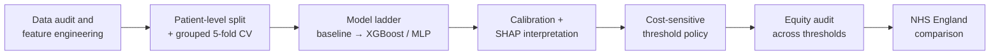
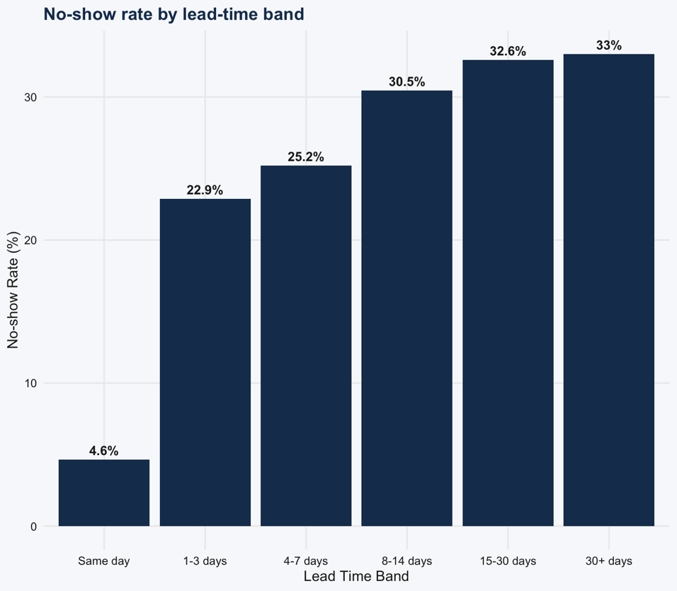
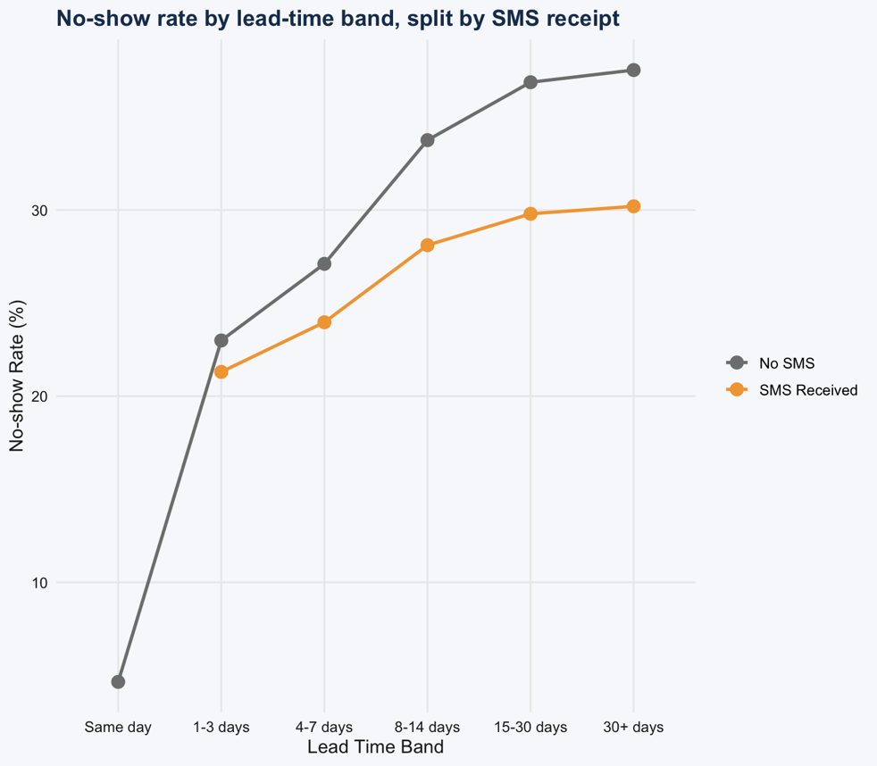
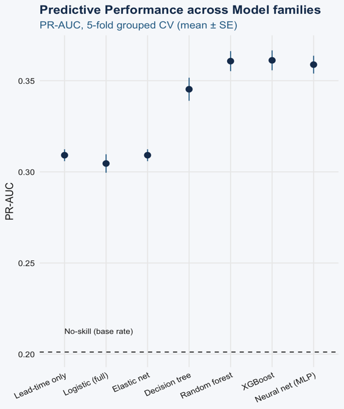
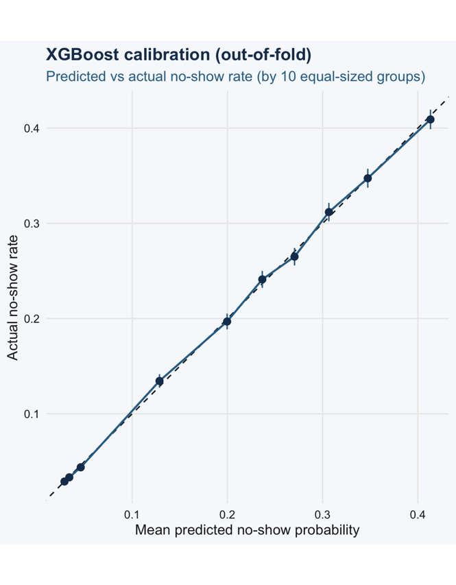
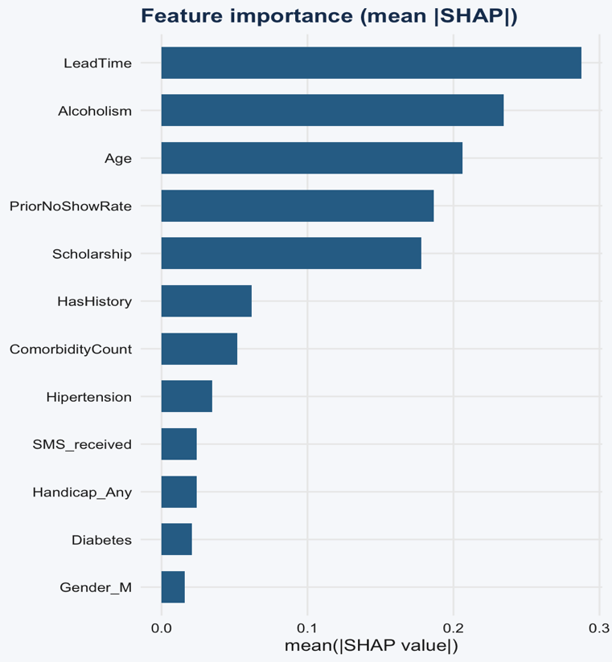
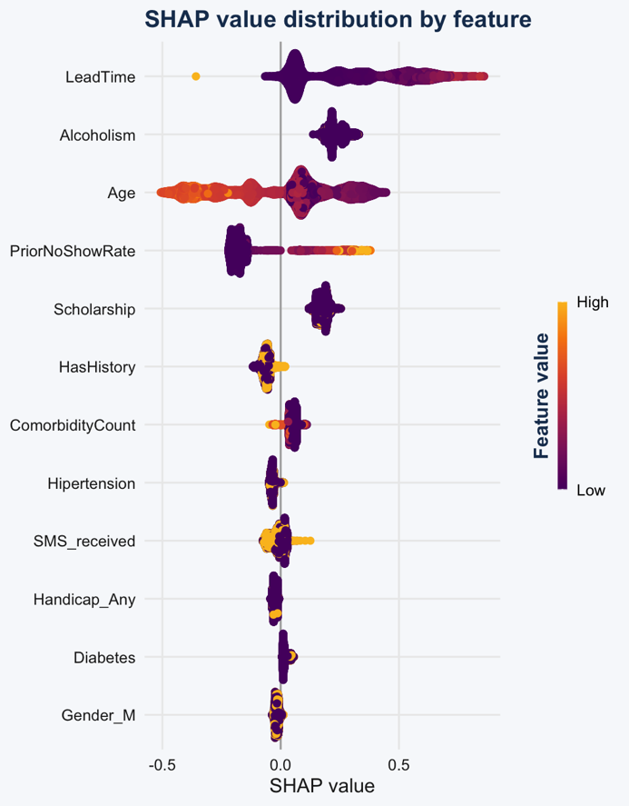
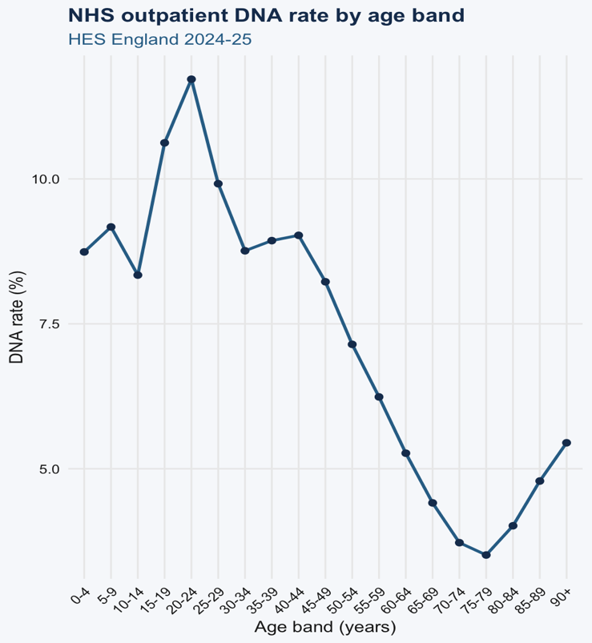

# Beyond Prediction: Cost-Sensitive and Equitable Targeting of Outpatient No-Shows

**MSc Business Analytics dissertation (September 2026)**
**Author:** Ria Goel  ·  **Tools:** R (tidymodels, XGBoost, ranger, glmnet, nnet, shapviz, probably, ggplot2, gt)

> Missed outpatient appointments waste clinical capacity and lengthen waiting lists. Machine learning can already predict *who* is likely to miss an appointment. This project asks the next question: **can those predictions be turned into a reminder policy that saves money and treats patient groups fairly?**

---

## Key results at a glance

| | Result |
|---|---|
| **Data** | 110,521 outpatient appointments from 62,299 patients, with a 20.2% no-show rate |
| **Best model** | XGBoost. On the held-out test set: **PR-AUC 0.378** (no-skill baseline 0.20), **ROC-AUC 0.738** |
| **Calibration** | Predicted and observed no-show rates within about 0.5 percentage points in every risk decile, so the probabilities can be used to make decisions |
| **Top drivers (SHAP)** | Lead time, alcoholism, age, prior no-show rate, welfare enrolment |
| **Cost analysis** | Do-nothing cost on the test set: **£543,360**. At 30% reminder effectiveness, a selective phone-call policy flags 65.6% of patients and saves **£79,961**. Cheap SMS reminders work best sent to everyone, saving £161,903 |
| **Equity finding** | Welfare-enrolled and non-enrolled patients are flagged at similar rates at threshold 0.12, but very differently at 0.29 (45.9% vs 26.3%). **Fairness depends on the threshold, not the model** |
| **NHS comparison** | The NHS England DNA rate (6.7%) is far lower than the Brazilian rate, but the same **decline in non-attendance with age** appears in both |

---

## Business problem

Reminder interventions cost different amounts. A text message costs about 5p, while a phone call needs staff time (about £5). If every patient gets the most expensive reminder, it isn't affordable. If no one does, services absorb the full cost of missed appointments, assumed here at £120–£165 each.

This dissertation treats no-shows as a **decision-support problem** rather than a plain classification task, and tests four things together:

1. **Prediction:** how well can routinely collected booking data predict a no-show?
2. **Calibration:** are the predicted probabilities reliable enough to act on?
3. **Cost:** when does *targeting* reminders beat reminding everyone or no one?
4. **Equity:** does the resulting policy treat welfare and age groups fairly?

## Approach



**Data preparation and leakage control**
- Removed 6 invalid records (a negative age and negative lead times) and engineered lead time, age bands, comorbidity count and a disability flag.
- Many patients have more than one appointment, so the data were split **by patient**, not by row: `group_initial_split()` for the 80/20 split and `group_vfold_cv()` for cross-validation. The checks confirmed zero patient overlap.
- Prior no-show history features (`PriorNoShows`, `PriorNoShowRate`) were built **after the split** and only from appointments completed before the current booking, so no record can see its own outcome or any later one.

**Modelling**
- Models were compared on identical folds and predictors, in order of complexity: majority-class baseline → lead-time-only logistic regression → full logistic regression → elastic net → decision tree → random forest → XGBoost → single-hidden-layer neural network.
- Hyperparameters were tuned with regular and space-filling grids. XGBoost used early stopping on an inner validation split.
- Evaluation used **PR-AUC** (suited to an imbalanced outcome), ROC-AUC and the Brier score. Accuracy was rejected because predicting "attends" for everyone already gives 79.9%.
- An experiment compared continuous terms, bands and natural splines, to test whether the weaker linear models were down to how the features were encoded or to the model itself.
- No resampling (e.g. SMOTE) was used, to keep the probabilities calibrated for the cost analysis.

**From prediction to decision**
- Cost-optimal threshold (Elkan, 2001), extended with reminder effectiveness *e*: **t\* = cᵢ / (cᵢ + c_d · e)**
- Sensitivity analysis across reminder costs (£0.05–£5), missed-appointment costs (£120 and £165) and effectiveness (25–35%).

**Equity audit**
- Compared demographic parity, true-positive-rate and false-positive-rate gaps between welfare-enrolled (Bolsa Família) and non-enrolled patients, swept across thresholds from 0.02 to 0.60.
- Age and welfare × age subgroups were analysed with Wilson 95% confidence intervals, and any cell under 300 patients was flagged as unreliable.

## Results

### Lead time is the strongest descriptive signal
The no-show rate rises from 4.6% for same-day bookings to about 33% for bookings made more than 30 days ahead.



### SMS reminders look harmful until you control for lead time
Unadjusted, receiving an SMS looks like the strongest risk factor (odds ratio ≈ 1.9). But within every lead-time band, patients who received an SMS missed *fewer* appointments. Reminders had mostly been sent for long-lead bookings, which were already the riskiest, so this is a classic case of confounding.



### Model comparison: non-linear models help, but all hit a similar ceiling

| Model | PR-AUC | ROC-AUC | Brier |
|---|---|---|---|
| Lead-time only | 0.311 | 0.700 | 0.159 |
| Logistic (full) | 0.305 | 0.664 | 0.154 |
| Elastic net | 0.309 | 0.698 | 0.158 |
| Decision tree | 0.345 | 0.722 | 0.145 |
| Random forest | 0.361 | 0.732 | 0.143 |
| **XGBoost** | **0.361** | **0.733** | **0.143** |
| Neural net (MLP) | 0.359 | 0.728 | 0.173 |
| **XGBoost – held-out test set** | **0.378** | **0.738** | **0.144** |

*Rows 1–7: 5-fold grouped cross-validation. Last row: final model on the untouched test set.*

 

The linear models added nothing beyond lead time alone, while the tree-based models improved on it. Because the best models perform so similarly, the limit on accuracy comes from the information in routine booking data, not from the choice of algorithm.

### What drives the predictions (TreeSHAP, full test set)

 

### Cost-sensitive targeting (30% reminder effectiveness, missed appointment = £120)

| Reminder cost | Threshold | % flagged | No-shows prevented | Policy cost | Saving vs do-nothing |
|---|---|---|---|---|---|
| £0.05 (SMS) | 0.0014 | 100.0% | 1,358 | £381,457 | £161,903 |
| £1.00 | 0.0270 | 97.5% | 1,354 | £402,470 | £140,890 |
| £5.00 (phone) | 0.1220 | 65.6% | 1,271 | £463,399 | £79,961 |

**Takeaway:** when reminders are cheap, it makes sense to send one to everyone. Predictive targeting earns its place only for **expensive interventions** that have to be rationed, such as phone calls or patient navigation.

### Equity audit: the threshold is a fairness decision

| Group (threshold 0.29) | n | Base rate | Flagged rate | TPR | FPR |
|---|---|---|---|---|---|
| Not enrolled | 19,910 | 0.200 | 0.263 | 0.476 | 0.210 |
| Welfare-enrolled | 2,194 | 0.247 | 0.459 | 0.769 | 0.357 |

At 0.12, both groups are flagged at almost the same rate (0.634 welfare-enrolled vs 0.659 not enrolled). The gap widens as the threshold rises and peaks between 0.27 and 0.32, where the TPR gap reaches 0.315. Because the two groups have different base rates, no threshold can satisfy every fairness criterion at once (Kleinberg et al., 2017). The cut-off should therefore be set and audited by the service, not left as a technical default.

### External check against NHS England data (HES 2024-25)



The NHS DNA rate falls from about 11.7% at ages 20–24 to about 3.5% at ages 75–79, the same age gradient seen in the Brazilian data. The NHS figures are aggregate, so this supports the broad pattern but **is not a validation of the model**.

## Recommendations for practice
- **Match the intervention to its cost.** Use universal SMS where it is affordable, and reserve risk-based targeting for staff-intensive contact.
- **Tier patients by calibrated risk**, so the most intensive contact goes to the highest-risk group.
- **Treat the threshold as a governance decision.** Audit it across patient groups before launch and every time it changes.

## Limitations
- The data come from a single Brazilian city in 2016 and are observational. The associations found are not causal.
- The cost of a missed appointment and the effectiveness of reminders are assumptions taken from the literature, so the savings are scenario estimates.
- Some welfare × age subgroups are small, so their estimates are uncertain.
- The NHS comparison uses aggregate data, so it cannot test the model's discrimination, calibration or thresholds.
- The next steps would be nested cross-validation, formal recalibration, temporal or external validation on individual-level NHS data, and Bayesian hyperparameter search.

## Repository structure

```
├── README.md
├── code/
│   ├── 01_eda.R            # Data audit, cleaning, feature engineering, EDA, effect sizes (Cramér's V, odds ratios)
│   └── 02_modelling.R      # Patient-level split, model ladder & tuning, calibration, SHAP,
│                           # cost-sensitive policy, equity audit, NHS England comparison
├── figures/                # Key figures from the dissertation
├── reports/
│   ├── Research_Report.pdf # Full dissertation (≈8,200 words)
│   └── Technical_Report.pdf# Implementation details, logbook, reflection and code appendix
└── data/README.md          # Where to download the (open) data
```

## How to run

The code is reproduced exactly as submitted in the technical report appendix. It was developed and run interactively in RStudio, one section at a time.

1. Download the two data files listed in [`data/README.md`](data/README.md) into your R working directory.
2. Install the packages:
   ```r
   install.packages(c("tidyverse", "lubridate", "scales", "psych", "rstatix", "corrplot",
                      "knitr", "gt", "hrbrthemes", "tidymodels", "xgboost", "glmnet",
                      "rpart", "ranger", "nnet", "probably", "shapviz", "readxl"))
   ```
3. Run `code/01_eda.R` for the exploratory analysis, then `code/02_modelling.R` one section at a time. A fixed random seed is used throughout.

## Skills demonstrated
`R` · `tidymodels` · `XGBoost` · `random forest` · `elastic net` · `neural networks` · `grouped cross-validation` · `data leakage prevention` · `hyperparameter tuning` · `probability calibration` · `SHAP explainability` · `cost-sensitive decision analysis` · `algorithmic fairness auditing` · `statistical testing` · `data visualisation (ggplot2, gt)` · `healthcare / NHS analytics`

---

*Generative AI was used only as an assistant (for debugging and formatting tables), as disclosed in the code comments and the reports. The analytical design and interpretation are the author's own.*
